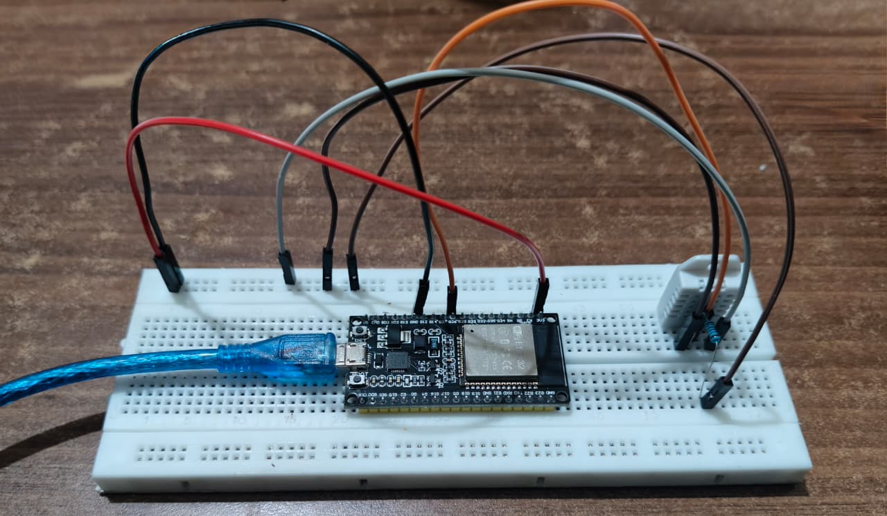
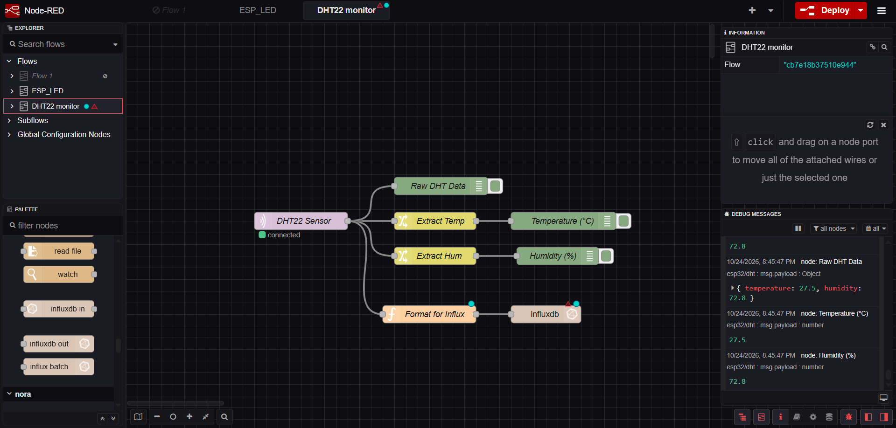
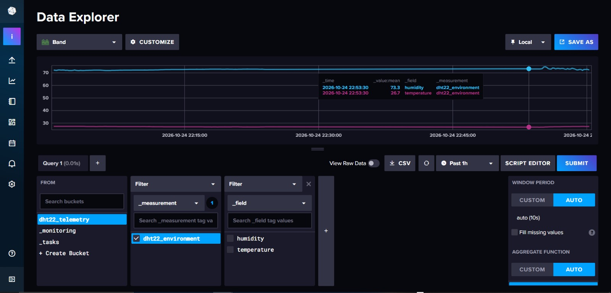
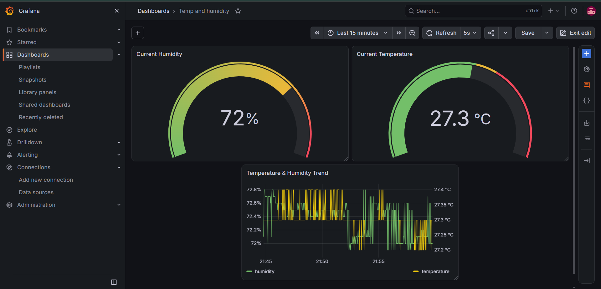

# ESP32 Dual-Core IoT Pipeline for DHT22 Sensor

A local, high-reliability multi-tier monitoring pipeline for the ESP32 and DHT22 sensor with cloud smart-home integration and UI dashboards.
(The system leverages dual-core FreeRTOS execution to decouple cloud smart-home synchronization from local high-frequency MQTT data publishing, ensuring zero telemetry dropouts during network latency spikes.)

## Hardware Circuit Setup

## Flow chart
                  +-------------------+
                  |    DHT22 Sensor   |
                  +---------+---------+
                            |
                            v
                  +-------------------+
                  |    ESP32 SoC      |
                  |  (FreeRTOS Dual)  |
                  +---+-----------+---+
                      |           |
        (Core 0: MQTT)|           |(Core 1: WebSocket)
                      v           v
       +--------------------+   +--------------------+
       |  Mosquitto Broker  |   |  Sinric Pro Cloud  |
       |    (Port 1883)     |   +---------+----------+
       +----------+---------+             |
                  |                       v
                  v             +--------------------+
       +--------------------+   |    Google Home     |
       |     Node-RED       |   |  (Live monitoring) |
       | (Parsing / Filter) |   +--------------------+
       +----------+---------+
                  |
                  v
       +---------------------+
       |    InfluxDB 2.x     |
       |Time series Telemetry|
       +----------+----------+
                  |
                  v
       +--------------------+
       |      Grafana       |
       |  (Flux Dashboards) |
       +--------------------+

## Methodology

1. **Edge Acquisition (ESP32 & FreeRTOS) :** 
   * **Core 0:** Samples the DHT22 every 2–5s and publishes JSON payloads via local MQTT.
   * **Core 1:** Maintains a secure WebSocket to Sinric Pro for Google Home voice queries without stalling telemetry.

2. **Smart Home Integration :** 
   * Bridges device states via Sinric Pro to Google Assistant for real-time monitoring

3. **MQTT Transport (Mosquitto) :** 
   * Local broker running on port `1883`, dispatching payloads

4. **Node-RED :** 
   * Subscribes to the MQTT topic, parses and formats JSON fields into numeric floats, and writes data via InfluxDB v2 REST API nodes.

5. **Time-Series Storage (InfluxDB 2.x):** 
   * Stores metrics (`temperature`, `humidity`) in the `dht22_telemetry` bucket under measurement `dht22_environment` on port `8086`.

6. **Visualization (Grafana):** 
   * Queries InfluxDB via **Flux** on a `5s` refresh interval. 
   * Renders a dual-axis time-series plot (°C vs %) and threshold-colored gauge dials for immediate comfort tracking.

## RESULTS

### Serial Monitor result

### Node Red

### Google Home monitoring

### Influx DB

### Grafana
